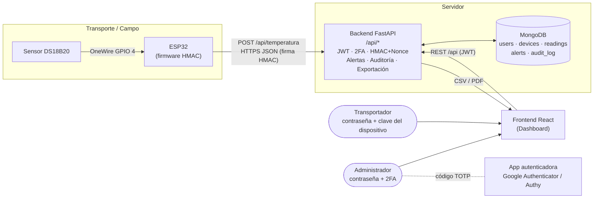

# ColdChain Dashboard — Monitoreo de Cadena de Frío para Biológicos

Plataforma web para monitorear y gestionar la cadena de frío de biológicos (vacunas) que deben mantenerse entre **2 °C y 8 °C**. Dispositivos **ESP32** con sensores **DS18B20** envían lecturas de temperatura a la API, y el dashboard las muestra en tiempo real con alertas visuales.

## Funcionalidades principales

- **Roles**
  - **Administrador**: control total, protegido con contraseña + **2FA (TOTP)** (Google Authenticator / Authy).
  - **Transportador**: solo ve los dispositivos que transporta, ingresando la contraseña física del hardware.
- **Aprobación de dispositivos**: todo ESP32 nuevo queda "Pendiente" hasta que un administrador lo aprueba.
- **Alertas** cuando la temperatura sale del rango 2–8 °C (advertencia / crítica) con reconocimiento.
- **Modo Seguro (HMAC-SHA256 + Nonce)**: firma de cada lectura y protección anti-replay por dispositivo.
- **Exportación** de lecturas por dispositivo en **CSV** y **PDF**.
- **Gestión de usuarios**: crear, deshabilitar, restablecer contraseña y cambio de contraseña propio.
- **Auditoría**: registro de quién hizo qué, cuándo y desde qué IP.
- Interfaz en **Español / Inglés**.

## Diagrama de contexto (arquitectura)



| Actor / Componente | Rol |
|--------------------|-----|
| **ESP32 + DS18B20** | Mide la temperatura y la envía a la API cada pocos segundos (opcionalmente firmada con HMAC). |
| **Backend FastAPI** | Valida dispositivos, guarda lecturas, genera alertas, registra auditoría y exporta reportes. |
| **MongoDB** | Persistencia de usuarios, dispositivos, lecturas, alertas y auditoría. |
| **Frontend React** | Dashboard para administradores y transportadores. |
| **App autenticadora** | Genera el código 2FA de los administradores. |

## Tecnologías

| Capa | Tecnología |
|------|------------|
| Backend | Python 3.11, FastAPI, Motor (MongoDB async), JWT, pyotp, ReportLab |
| Frontend | React, Tailwind CSS, Shadcn UI, Axios |
| Base de datos | MongoDB |
| Hardware | ESP32 + DS18B20 (`ESP32_firmware_HMAC.ino`) |

## Estructura

```
backend/
  server.py        Capa API (endpoints FastAPI, autenticación, traducción de errores a HTTP)
  services.py      Servicios de aplicación y reglas de negocio de RF-01 y RF-02
  repositories.py  Capa de persistencia (consultas a MongoDB)
  models.py        Contratos de entrada (Pydantic)
  seed_demo.py     Datos de demostración idempotentes y reinicio de datos de prueba
  tests/           Pruebas funcionales y scripts de RNF
frontend/          Aplicación React (src/pages, src/components)
documentacion/     Entregas del curso y evidencias de pruebas
ESP32_firmware_HMAC.ino   Firmware de ejemplo para el ESP32
```

## Ejecución local

### Requisitos
- Python 3.11
- Node.js 20 y Yarn (`npm install -g yarn`)
- MongoDB en ejecución (local o MongoDB Atlas)

### 1. Backend

```bash
cd backend
python -m venv venv
source venv/bin/activate          # Windows: venv\Scripts\activate
pip install -r requirements.txt
```

Crear `backend/.env` (o copiar `backend/.env.example`):

```
MONGO_URL=mongodb://localhost:27017
DB_NAME=coldchain_db
CORS_ORIGINS=http://localhost:3000
JWT_SECRET=una_clave_larga_y_aleatoria
ADMIN_EMAIL=admin@ejemplo.com
ADMIN_PASSWORD=cambiar_esta_clave
```


Iniciar el servidor:

```bash
uvicorn server:app --host 0.0.0.0 --port 8001 --reload
```

Al arrancar se crea automáticamente el administrador definido en `ADMIN_EMAIL` / `ADMIN_PASSWORD`. Documentación de la API: http://localhost:8001/docs

### 2. Frontend

```bash
cd frontend
yarn install
```
Si la terminal no reconoce yarn como comando usar `npm install -g yarn`.

Crear `frontend/.env`:

```
REACT_APP_BACKEND_URL=http://localhost:8001
```

Iniciar:

```bash
yarn start
```

Abrir http://localhost:3000. En el primer inicio de sesión el administrador debe **cambiar su contraseña** y **configurar el 2FA** escaneando el código QR.

### 3. Conectar el ESP32

#### Diagrama de conexión DS18B20 → ESP32

El firmware usa el pin **GPIO 4** como bus OneWire (`ONE_WIRE_BUS = 4`).

```
        DS18B20 (sonda)                      ESP32 DevKit
   ┌──────────────────────┐
   │  Rojo     (VDD)  ────┼──────────┬───────── 3V3
   │                      │          │
   │                      │       [ 4.7 kΩ ]   ← resistencia pull-up
   │                      │          │
   │  Amarillo (DATA) ────┼──────────┴───────── GPIO 4
   │                      │
   │  Negro    (GND)  ────┼──────────────────── GND
   └──────────────────────┘
```

| Cable DS18B20 | Función | Pin ESP32 |
|---------------|---------|-----------|
| Rojo | Alimentación (VDD) | **3V3** |
| Amarillo (a veces blanco) | Datos (DQ) | **GPIO 4** |
| Negro | Tierra | **GND** |

Notas:
- La **resistencia de 4.7 kΩ entre DATA y 3V3 es obligatoria**; sin ella el sensor devuelve `-127 °C` o `85 °C`.
- Alimentar con **3.3 V** (no 5 V) para no exceder el nivel lógico del ESP32.
- En la versión TO-92 (encapsulado tipo transistor), con la cara plana hacia ti: pines **GND – DATA – VDD** de izquierda a derecha.
- Librerías necesarias en Arduino IDE: **OneWire** y **DallasTemperature**.
- Para usar otro pin, cambia `ONE_WIRE_BUS` en `ESP32_firmware_HMAC.ino`.

#### Configuración del firmware
1. En el firmware, configurar el WiFi y la URL del servidor usando la IP de la PC (no `localhost`), por ejemplo:
   `http://192.168.1.50:8001/api/temperatura`
2. El ESP32 y la PC deben estar en la misma red, con el puerto **8001** permitido en el firewall.
3. Al enviar la primera lectura, el dispositivo aparece como **Pendiente** en el dashboard; un administrador debe aprobarlo.

Ejemplo de lectura enviada por el ESP32:

```json
POST /api/temperatura
{
  "deviceId": "ESP32_VACUNA_001",
  "devicePassword": "PASS_SECRETA_123",
  "temperature": 5.4
}
```

## Endpoints principales

| Método | Ruta | Descripción |
|--------|------|-------------|
| POST | `/api/auth/login` | Inicio de sesión |
| POST | `/api/temperatura` | Ingesta de lecturas del ESP32 |
| GET | `/api/devices` | Lista de dispositivos |
| POST | `/api/devices/approve` | Aprobar dispositivo |
| GET | `/api/devices/{id}/export?format=csv\|pdf` | Exportar lecturas |
| POST | `/api/devices/{id}/secure-mode` | Activar/desactivar Modo Seguro |
| GET | `/api/admin/users` | Gestión de usuarios |
| GET | `/api/admin/audit` | Registro de auditoría |
| GET | `/api/alerts?active_only=true` | Listar alertas (RF-02) |
| POST | `/api/alerts/{id}/ack` | Reconocer alerta (RF-02) |
| POST | `/api/devices/{id}/alerts/ack-all` | Reconocer todas las alertas de un dispositivo (RF-02) |

Los contratos completos (entradas, respuestas y errores) están en `documentacion/ColdChain_Dashboard_Semana14_pruebas.md`.

## Pruebas (Semana 14)

Con el backend corriendo en `http://localhost:8001`, desde la carpeta `backend`:

```bash
# RF-01, RF-02 y RNF-01, 02, 05, 06 (25 pruebas, ~80 s)
REACT_APP_BACKEND_URL=http://localhost:8001 pytest tests/test_semana14_rf.py -v
#   Windows PowerShell: $env:REACT_APP_BACKEND_URL="http://localhost:8001"; pytest tests/test_semana14_rf.py -v

# RNF-03: latencia p95 de 100 lecturas (umbral 500 ms)
python tests/rnf03_latencia.py --base-url http://localhost:8001 --n 100 --out ../documentacion/evidencias/rnf03_latencia.json

# RNF-04: persistencia tras reiniciar backend y MongoDB (dos fases)
python tests/rnf04_reinicio.py antes   --base-url http://localhost:8001 --state ../documentacion/evidencias/rnf04_estado.json
#   ...reiniciar uvicorn y MongoDB...
python tests/rnf04_reinicio.py despues --base-url http://localhost:8001 --state ../documentacion/evidencias/rnf04_estado.json --out ../documentacion/evidencias/rnf04_reinicio.json

# Reiniciar datos de prueba (borra TEST_*) y cargar dispositivos demo
python seed_demo.py --reset
```

### Matriz RF-RNF (resultados del 2026-11-14)

| RF / RNF | Calidad ISO/IEC 25010:2023 | Meta | Resultado | Evidencia |
|----------|----------------------------|------|-----------|-----------|
| RF-01 / RNF-01 | Seguridad / Autenticidad | 100 % de contraseñas inválidas rechazadas (401) sin guardar | Cumple (10/10) | `tests/test_semana14_rf.py` |
| RF-01 / RNF-02 | Seguridad / Integridad | 100 % de HMAC inválido (401) y replay (409) rechazados | Cumple (5/5) | `tests/test_semana14_rf.py` |
| RF-01 / RNF-03 | Eficiencia / Comportamiento temporal | p95 ≤ 500 ms en 100 solicitudes | Cumple (p95 = 270 ms) | `documentacion/evidencias/rnf03_latencia.json` |
| RF-01 / RNF-04 | Fiabilidad / Recuperabilidad | 100 % de lecturas consultables tras reinicio | Cumple (20/20) | `documentacion/evidencias/rnf04_reinicio.json` |
| RF-02 / RNF-05 | Adecuación funcional / Corrección | 7 valores límite clasificados correctamente | Cumple (7/7) | `tests/test_semana14_rf.py` |
| RF-02 / RNF-06 | Fiabilidad / Ausencia de fallos | Inactivo tras más de 60 s sin lecturas | Cumple | `tests/test_semana14_rf.py` |

Detalle completo, contratos y checklist: `documentacion/ColdChain_Dashboard_Semana14_pruebas.pdf`.
